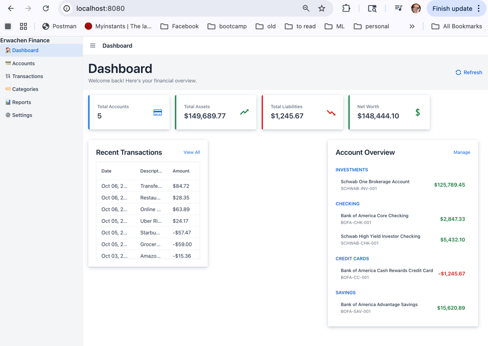
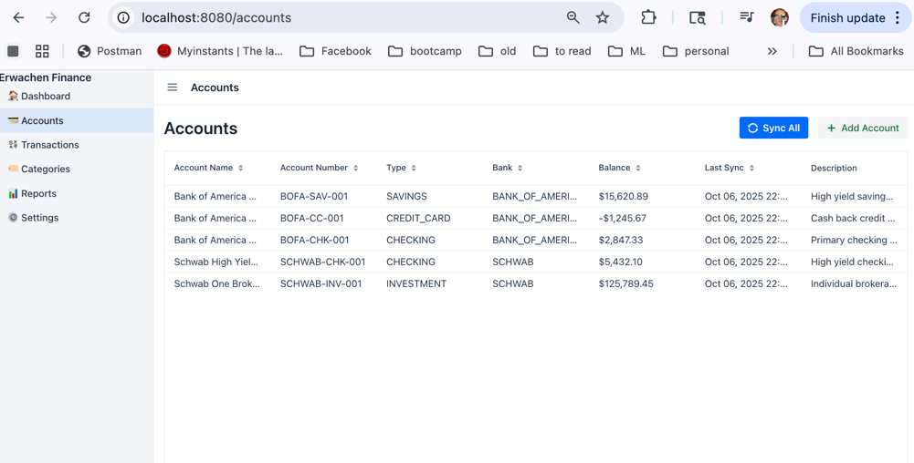
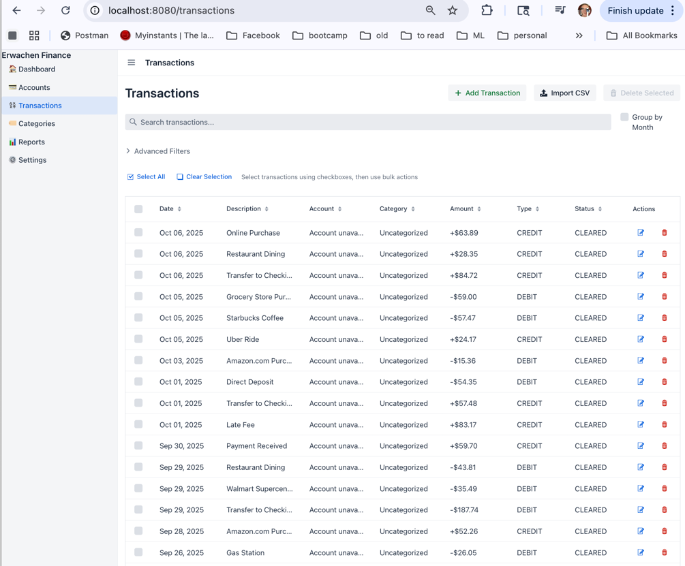
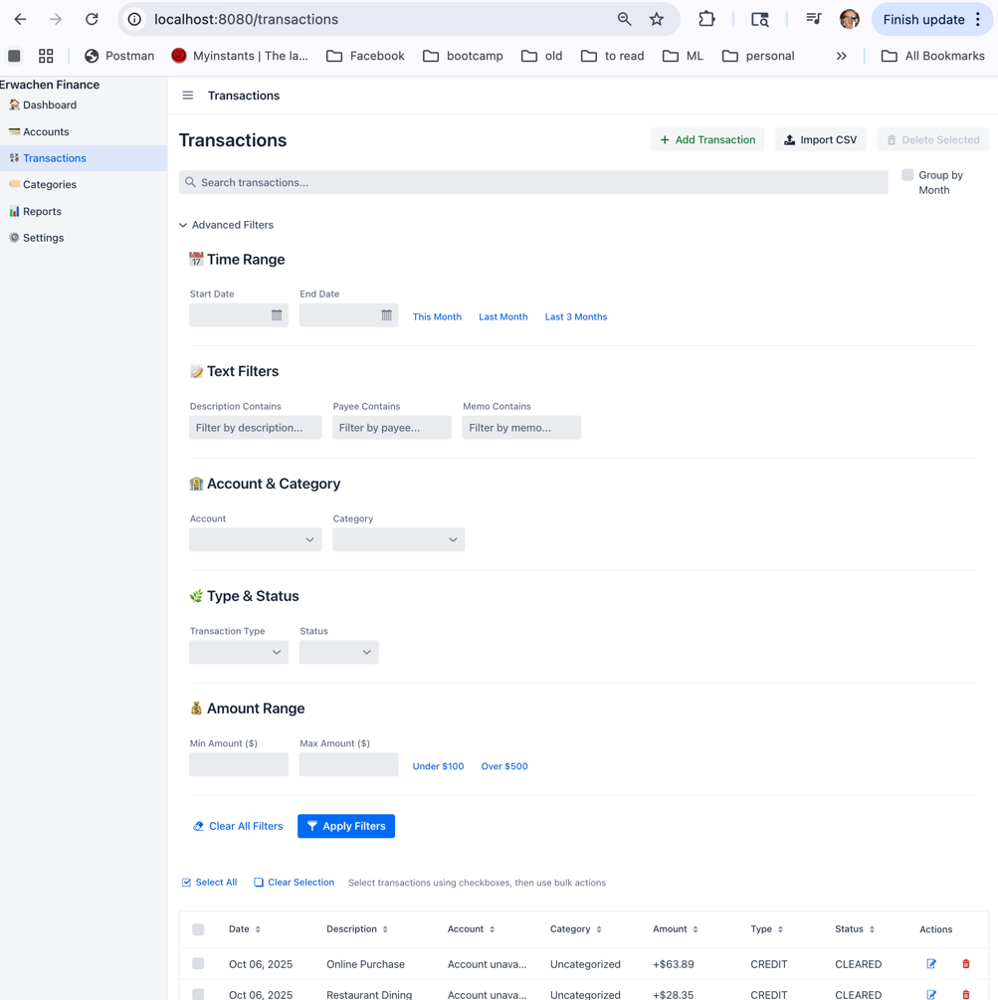
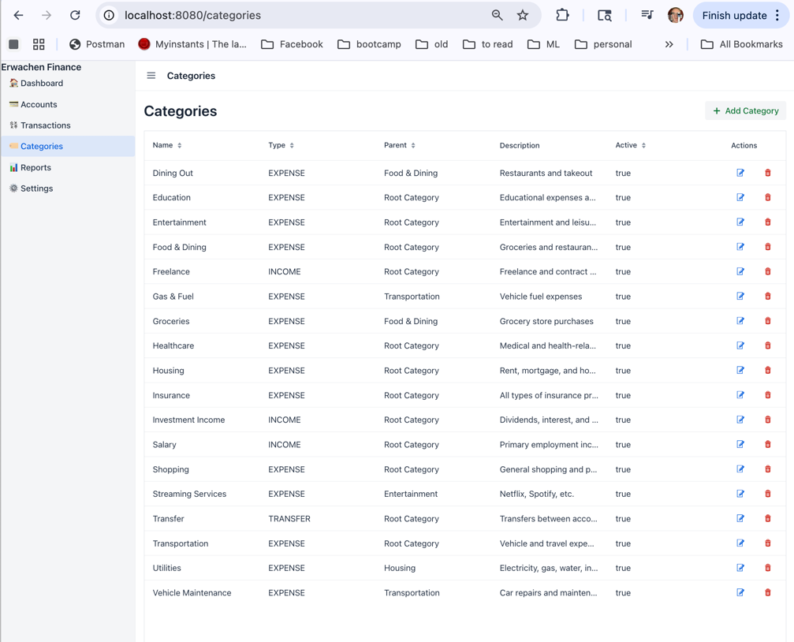
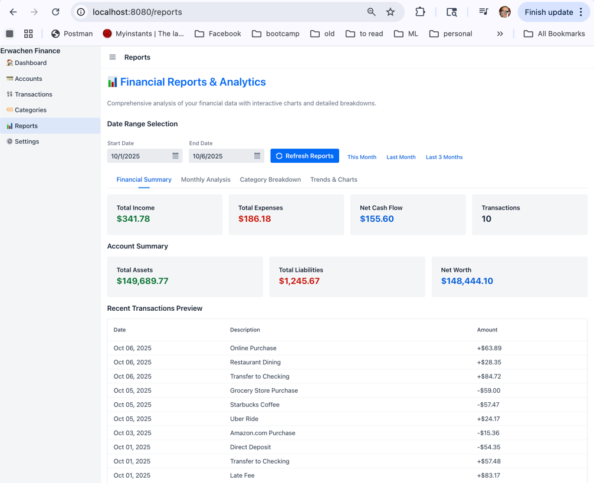
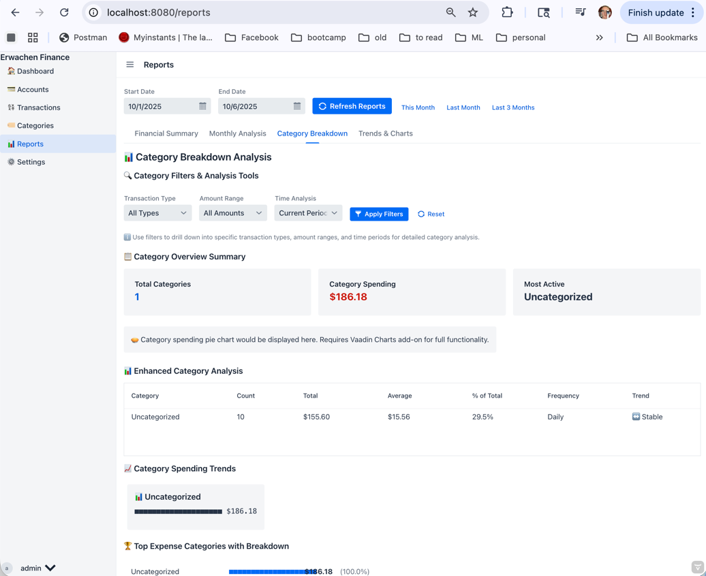

<p align="center">
  
</p>

# Erwachen Finance Management Application

A comprehensive Spring Boot application with Vaadin Flow UI for personal finance management, featuring bank account integration with Schwab and Bank of America.

## Features

- **Dashboard**: Overview of financial status with account summaries and recent transactions
- **Account Management**: View and manage multiple bank accounts from different providers
- **Transaction Management**: Track and categorize financial transactions
- **Category System**: Hierarchical expense categorization with automatic categorization
- **Bank Integration**: Placeholder integration with Schwab and Bank of America APIs
- **Real-time Sync**: Automatic synchronization of account balances and transactions
- **Expense Tracking**: Monitor spending patterns and financial trends

## Technology Stack

- **Backend**: Spring Boot 3.2.0, Spring Data JPA, Spring Security
- **Frontend**: Vaadin Flow 24.2.0
- **Database**: H2 (development), PostgreSQL (production ready)
- **Build Tool**: Maven
- **Java Version**: 21 (Amazon Corretto 23)










## Quick Start


### Prerequisites

- Java 21+ (Amazon Corretto 23 recommended)
- Maven 3.6+

### Running the Application

1. **Clone the repository** (if applicable):
   ```bash
   git clone <repository-url>
   cd erwachen-app
   ```

2. **Build and run**:
   ```bash
   mvn clean install
   mvn spring-boot:run
   ```

3. **Access the application**:
   - Open your browser and navigate to: `http://localhost:8080`
   - Login credentials:
     - **Admin**: username: `admin`, password: `admin123`
     - **User**: username: `user`, password: `user123`

### Development Database Access

The application uses an in-memory H2 database for development. You can access the database console at:
- URL: `http://localhost:8080/h2-console`
- JDBC URL: `jdbc:h2:mem:erwachen`
- Username: `sa`
- Password: `password`

## Application Structure

```
src/main/java/com/finance/erwachen/
├── config/          # Configuration classes
├── entity/          # JPA entities
├── repository/      # Data repositories
├── service/         # Business logic services
├── service/bank/    # Bank integration services
├── ui/              # Vaadin UI components
└── ErwachenApplication.java
```

### Key Components

#### Entities
- **Account**: Bank account information and balances
- **Transaction**: Financial transactions with categorization
- **Category**: Hierarchical expense categories

#### Services
- **AccountService**: Account management and synchronization
- **TransactionService**: Transaction processing and categorization
- **CategoryService**: Category management
- **Bank Services**: Schwab and Bank of America integration (placeholder)

#### UI Views
- **DashboardView**: Financial overview and quick actions
- **AccountsView**: Account management interface
- **TransactionsView**: Transaction browsing and search
- **CategoriesView**: Category management
- **ReportsView**: Financial reports (placeholder)
- **SettingsView**: Application settings (placeholder)

## Bank Integration

### Current Implementation

The application includes placeholder implementations for:
- **Schwab API Integration**: Sample account and transaction data
- **Bank of America API Integration**: Sample account and transaction data

### Configuring Bank APIs

Update the configuration in `application.yml`:

```yaml
bank:
  schwab:
    api-url: https://api.schwab.com
    client-id: ${SCHWAB_CLIENT_ID:your-client-id}
    client-secret: ${SCHWAB_CLIENT_SECRET:your-client-secret}
    redirect-uri: http://localhost:8080/callback/schwab
  
  bofa:
    api-url: https://api.bankofamerica.com
    client-id: ${BOFA_CLIENT_ID:your-client-id}
    client-secret: ${BOFA_CLIENT_SECRET:your-client-secret}
    redirect-uri: http://localhost:8080/callback/bofa
```

Set environment variables or replace placeholder values with actual API credentials.

### Adding Real Bank Integration

To implement real bank API integration:

1. **Replace placeholder methods** in `SchwabBankService` and `BofaBankService`
2. **Implement OAuth2 authentication** flows for each bank
3. **Add proper error handling** and rate limiting
4. **Implement data mapping** from bank API responses to internal entities

## Sample Data

The application automatically creates sample data on startup:

- **Categories**: Default income and expense categories with subcategories
- **Accounts**: Sample accounts from both Schwab and Bank of America
- **Transactions**: 3 months of sample transaction data with partial categorization

## Security

- **Spring Security**: Basic authentication with in-memory users
- **Vaadin Security**: Integrated with Spring Security
- **Role-based Access**: Admin and User roles (currently both have full access)

### Default Users

- **Admin User**: `admin` / `admin123` (ADMIN, USER roles)
- **User**: `user` / `user123` (USER role)

## Features in Detail

### Dashboard
- Financial summary with total assets, liabilities, and net worth
- Account overview with current balances and sync status
- Recent transactions with filtering and search
- Quick actions for account synchronization and data import

### Account Management
- View all linked accounts across different banks
- Manual and automatic account synchronization
- Account balance tracking and history
- Support for different account types (checking, savings, credit card, investment, loan)

### Transaction Management
- Comprehensive transaction listing with pagination
- Search and filter capabilities
- Automatic and manual transaction categorization
- Transaction reconciliation features
- Import transactions from bank APIs

### Category System
- Hierarchical category structure (categories and subcategories)
- Automatic transaction categorization based on payee and description
- Income, expense, and transfer category types
- Category-based spending analysis

## Configuration

### Database Configuration

**Development (H2)**:
```yaml
spring:
  datasource:
    url: jdbc:h2:mem:erwachen
    username: sa
    password: password
```

**Production (PostgreSQL)**:
```yaml
spring:
  datasource:
    url: jdbc:postgresql://localhost:5432/erwachen
    username: ${DB_USERNAME}
    password: ${DB_PASSWORD}
    driver-class-name: org.postgresql.Driver
```

### Logging Configuration

Adjust logging levels in `application.yml`:
```yaml
logging:
  level:
    com.finance.erwachen: DEBUG
    org.springframework.security: INFO
```

## Development

### Building the Application

```bash
# Clean and compile
mvn clean compile

# Run tests
mvn test

# Build JAR
mvn clean package

# Run with specific profile
mvn spring-boot:run -Dspring-boot.run.profiles=dev
```

### Adding New Features

1. **Entities**: Add new JPA entities in the `entity` package
2. **Repositories**: Create corresponding repositories in the `repository` package
3. **Services**: Implement business logic in the `service` package
4. **UI**: Create Vaadin views in the `ui` package
5. **Configuration**: Update security and other configurations as needed

### Testing

The application includes:
- **Unit Tests**: For service layer logic
- **Integration Tests**: For repository and database operations
- **UI Tests**: For Vaadin component testing (to be implemented)

## Deployment

### Jar Deployment

```bash
# Build JAR
mvn clean package -Dmaven.test.skip=true

# Run JAR
java -jar target/erwachen-app-0.0.1-SNAPSHOT.jar
```

### Environment Variables

Set the following environment variables for production:

```bash
export SCHWAB_CLIENT_ID=your_schwab_client_id
export SCHWAB_CLIENT_SECRET=your_schwab_client_secret
export BOFA_CLIENT_ID=your_bofa_client_id
export BOFA_CLIENT_SECRET=your_bofa_client_secret
export DB_USERNAME=your_db_username
export DB_PASSWORD=your_db_password
```

## Future Enhancements

- **Real Bank API Integration**: Implement actual bank API connections
- **Advanced Reporting**: Charts, graphs, and financial analytics
- **Budget Management**: Budget creation and tracking
- **Bill Management**: Recurring bill tracking and alerts
- **Investment Tracking**: Portfolio management and performance tracking
- **Mobile App**: React Native or Flutter mobile application
- **API Layer**: REST API for third-party integrations
- **Multi-user Support**: User management and data isolation
- **Data Export**: CSV, PDF, and Excel export functionality
- **Notification System**: Email and SMS alerts for transactions

## Support

For issues and questions:
1. Check the application logs for error messages
2. Verify database connectivity and configuration
3. Ensure Java 21+ is properly installed
4. Check that all required dependencies are available

## License

This application is created for educational and personal use.